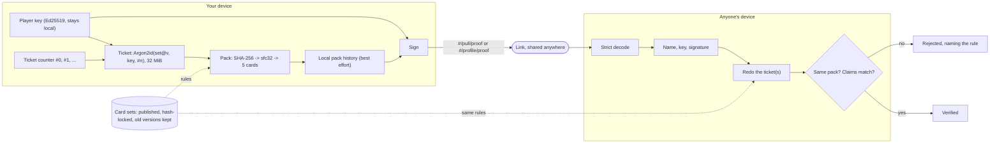

# Architecture

Brainrot TCG is a static Vite + React site, deployable to GitHub Pages or Cloudflare Pages, with
**no authoritative game backend**. Player state lives in browser storage; public pull proofs let
others independently derive the same cards. GitHub workflows and a configured Cloudflare cron
Worker handle submissions and publication, not pack generation.

## Verification at a glance

No server decides what anyone pulled. A ticket uses fixed Argon2id parameters for a set version,
public key and nonce; elapsed time depends on hardware. A signed pull link binds those inputs and
its name, and a verifier derives the same pack with `derivePack(set, key, ticket#)`. A valid proof
establishes that result and the signing key, not browser-only play, a human action or an opening time.



GitHub keeps verified submission issues used to build the Hall of Fame list; public Nostr relays
carry submissions from players without a GitHub account. Either can omit or delay submissions. The build verifies issues
(or reuses cached verification), while the Hall of Fame UI re-checks entries in the current top 30
one at a time; it does not re-verify the whole published list. Opening a pull link verifies its proof.
`spec/verify_pull.py` independently implements the proof spec with different libraries, and CI
checks both implementations against both sets of test vectors.

## Layers

```
src/engine/        Pure TypeScript. No React, no DOM, no Vite. Runs in the browser, a Web Worker and Node (CI).
  pack.ts            seeded PRNG + deterministic pack generation (integer-only odds)
  ticket.ts          Argon2id proof-of-work: the cost of one pack
  identity.ts        Ed25519 player keys, fingerprints, name rules
  proof.ts           pull proofs: encode / decode / sign / verify
  scoring.ts         Brainrot Score: rarity points x combo multipliers, all derived from the odds
  odds.ts            exact combo odds for any set (powers the in-game scoring guide)
  hallOfFame.ts      what qualifies for the Hall of Fame (shared by UI and CI)

src/content/       Set data, art and registry; existing schemas use the existing engine.
  sets/<set>/set.json  cards (id, name, rarity, caption, flavor, art brief), odds, holo odds
  sets/<set>/art/      source art (real images, full cards, or SVG placeholders)
  sets/<set>/cards/    built card images (npm run cards); committed
  sets/<set>/finish-thumbs/  small ready-made metallic finishes for the collection; committed
  sets/<set>/pack.webp the set's booster pack wrapper, built from its colours and rarest cards
  sets/index.ts        the registry: every version of every set (old versions and archived sets stay for old proofs)
  sets.lock.json       hash of each released set@version (npm run check:sets)

src/game/          Browser glue around the engine.
  player.ts          the local player key, name and ticket counter (localStorage)
  ticketMiner.ts     serial opening-ticket queue, worker/main-thread fallback, next-pack prefetch
  ticketPool.ts      separate verification/reconstruction pool, up to 8 workers (32 MiB each)
  history.ts         compact localStorage ticket metadata/cards; quota can discard old records
  profiles.ts        signed profile construction, verification and background own-pack reconstruction
  packStore.ts       reconstructed own-pack card codes in memory and IndexedDB
  reopenCache.ts     localStorage cache for packs derived while viewing public profiles
  pulls.ts           openPack(), proofFor(), pullUrl(), checkPull()
  share.ts, bragImage.ts   brag text, Hall of Fame submit, 9:16 pull poster and player card with QR
  progression.ts     titles, card backs, pack foils, collection milestones, set completion
  shareActions.ts    copy/download and API-supported coarse-pointer system sharing
  previewLinks.ts    link previews: shared links go through a static page per hand and its cards
  hallOfFameList.ts  the published Hall of Fame list, loaded once per visit
  nostrInbox.ts      Hall of Fame submissions over public Nostr relays (loaded only when used)
  move.ts            hands a save over from the site's old address, window to window (docs/HOSTING.md)

src/components/    React UI (pack opening, collection, set picker, share sheet, pull viewer, pages)

spec/              The proof spec (PULL_SPEC.md), test vectors, and verify_pull.py: an independent
                   Python verifier written only from the spec. CI runs both verifiers on both vector files.

scripts/           Node tools (run with tsx)
  cards/             card compositor (Genesis frame + art + text), pack wrappers, previews, prompt sheets
  check-sets.ts      set lock guard
  hall-of-fame.ts    verifies Hall of Fame issues; files Nostr submissions; builds public/hall-of-fame.json
  hof-inbox.ts       the inbox rules: verify, dedupe, budget, retry
  preview-pages.ts   after the Vite build: a preview picture and page for every hand each set can make
  redirect-site.ts   the old address after a move: forwards every link and brings saves along
```

## How a pull works

```
player key (Ed25519)  ─┐
set@version           ─┼─► Argon2id ticket (32 MiB, 2 iterations) ─► SHA-256 ─► sfc32 PRNG ─► 5 cards + modifiers
ticket number (nonce) ─┘
```

- Opening allocates the next ticket number before deriving its cards. `ticketMiner.ts` queues work
  serially and prefetches the next ticket while a pack is shown. Prefetch can reduce waits, but slow
  devices, worker failures and competing work can still delay opening; fallback uses the main thread.
- A **proof** is `(set, version, public key, nonce, name)` signed with the player's key and
  base64url-encoded into `#/pull/<proof>` links; its size varies with those fields.
- **Verifying** means recomputing the ticket and the pack from the proof. Nothing can be edited:
  changing any byte breaks the signature, and the cards are never part of the proof (they're re-derived).

### Why proof-of-work

Without a server nobody can witness pack openings, so the game can't stop players choosing which
pulls to show. Every tested ticket must use the same configured derivation function, whether it is
opened in the UI or searched by a local miner. Argon2id is memory-hard, but this is not a rate limit:
parallel implementations, GPUs and more capable machines can search faster. There is no measured
hardware-fairness guarantee.

Known limits: a proof cannot establish how many tickets someone searched, that they used the
browser or that a human opened a pack. "Verified" means *these cards derive from the signed ticket
inputs*. Hall of Fame "world firsts" use the bot's verification time, not a witnessed opening time.

Strict key/signature validation and canonical encoding rules are specified in `spec/PULL_SPEC.md`
section 7 and covered by the vectors, including small-order key and malleable-encoding cases.

## Hall of Fame (no server)

There are two submission paths; the default relay path needs no GitHub account.

```
player ─► Share ─► "Submit"  ─► signed Nostr event ─► 5 public relays
                                                          │  configured 15-minute Cloudflare cron
                    .github/workflows/hall-of-fame-inbox.yml
                    scripts/hall-of-fame.ts inbox  ─► bot-filed issue + comment + labels (+ redeploy)
                                   │
player ─► Share ─► "on GitHub" ─► GitHub issue form (pull link; needs an account)
                                   │
                    .github/workflows/hall-of-fame.yml
                    scripts/hall-of-fame.ts verify-issue  ─► comment + labels (+ redeploy)
                                   │
                    .github/workflows/deploy.yml
                    scripts/hall-of-fame.ts build  ─► public/hall-of-fame.json (top 100 + firsts)
                                   │
                    Hall of Fame page checks current top 30; pull links verify individually
```

**Without an account** (`src/game/nostrInbox.ts`): the game wraps the pull proof in a Nostr event
(NIP-78 application data, kind 30078), signs it with a
throwaway key made for that one submission, and sends it to five open relays. The throwaway key is
only a transport: who pulled it comes from the proof's own signature. The inbox job reads the last
week of events, checks each event's signature, verifies the pull with the same engine as everything
else, and files the ones that qualify as issues in the same verified state the GitHub path ends in.
Each run re-derives at most 300 pulls and files at most 20. It remembers handled event IDs in an
Actions cache (latest 20,000) and skips already verified pulls. Fetching requests up to 50 pages of
100 events per relay within a 60-second connection deadline, over a seven-day window. These are
client request limits, not guarantees that relays return or retain every event or obey the limits.
Only valid event signatures are retained, and the exact proof text in the link is accepted. A filing
that stops after opening an issue can reuse that issue on retry. Deferred submissions are eligible
on a later run only while still available in the fetched window; cache eviction and service errors
can cause repeat work or missed submissions.

The inbox workflow has a best-effort GitHub schedule and a concurrency group that serializes inbox
runs. `workers/hall-of-fame-cron/` defines a 15-minute dispatch trigger when deployed and configured;
source configuration alone does not prove it is running. Public relays and eligible public-repository
Actions can be used without a game server, subject to provider limits and availability. If intake
stops, the UI may show pending relay pulls after checking up to ten candidates per visit (own
submissions first), but this does not guarantee delivery or later inclusion in the published list.

A relay can drop a submission (that's why there are five) or flood the inbox with junk (each run
limits expensive pull derivations, and junk is skipped). It cannot forge a valid signature or alter
what a valid ticket derives; server/build verification and the UI checks described above enforce
those proof rules, rather than delivery or mining fairness. A maintainer can drop an entry using
its issue's `rejected` label.

**Published list.** The Hall of Fame is the top 100 pulls by Brainrot Score plus the first Full
House, 4 of a Kind and 5 of a Kind in each set. The output is bounded by 100 plus three firsts per set,
with overlapping entries deduplicated; it grows with the number of sets. The rules
live in `src/engine/hallOfFame.ts`. The share sheet and intake test whether a qualifying pull would
join the available published snapshot; when it cannot be loaded, they fall back to qualification.
The deploy writes the ranked list. Workflows attempt to close verified issues, and the build reads
both open and closed states. Deploys keep each verified issue's result
in the Actions cache, keyed on the engine, the sets and the script. Unchanged issues can reuse their
verification result, but the build still lists verified issues across open and closed states; cache
misses, changed inputs and API failures affect work and freshness.

Issue text is untrusted: it's only parsed by the script, never put into a shell command, and only
echoed back through a sanitiser. The submitter's GitHub username comes from GitHub. "World first"
order uses the time the bot first verified that exact pull on the issue (a marker in its comment), not
the issue's creation date, so a placeholder issue edited later can't claim an earlier spot. Each pull
counts once, however many times it's submitted or re-signed. A maintainer can drop an entry by adding
the `rejected` label to its issue.

## Sharing and link previews

Sharing copies the link or poster image; a system share sheet is offered on coarse-pointer devices
when the browser supports it. A pull link carries its whole proof, making it independently checkable;
its length depends on the signed fields.

Chat apps build a link preview from the page address alone, and the proof is after the `#`, which
they never see. So a copied link goes through a static page for the pack's hand and the cards that
make it, `p/<code>.html#/pull/<proof>` (the code is 8 hex characters of
`sha256("set/card+card/HAND")`, fixed forever). Its picture is the pack as five cards: those cards
face up as many times as the hand has them, the rest face down. A Full House is the whole pack, Two
Pair both pairs, 3 or 4 of a Kind or a Pair the matching card, and No Matches the best card. A card
shared on its own gets a page with just that card (`sha256("set/card")`).

The deployed preview pages are generated ahead of time for the supported hands and cards, rather
than generated for each unique pull. Their count and size grow with the published content.
`scripts/preview-pages.ts` writes them after the Vite build, with pages titled like "A Full House in Summer of Slop", and keeps the pictures in `.cache/previews/`
(cached in CI too) so only new or changed ones are drawn. The pages forward to the pull. The path only
picks the preview; the pull is still re-derived from the proof when it's opened.

## Hosting

`.github/workflows/deploy.yml` selects Cloudflare Pages when its account/token configuration works,
otherwise GitHub Pages; `BASE_PATH` and `SITE_URL` determine built paths and preview addresses. Both
have free static-hosting options, with provider build, storage, traffic and service limits; custom
domains or additional services can cost money. See `docs/HOSTING.md` for configuration and old-address
redirects. Save transfer uses origin-checked window-to-window postMessage, not URL contents; storage
failures and unsupported moves still need recovery and are not guaranteed lossless (#181).

## Profiles and levels (no server)

A profile link (`#/profile/<proof>`, spec section 11) signs a declared contiguous range of tickets
from #0, the set version assigned to each, XP and up to five best tickets. The viewer derives that
range and checks the claims. It cannot prove that the range includes all lifetime mining activity,
that no other keys were used, or when packs were opened.

`src/game/profiles.ts` checks decoding/signature first, then derives highlights before the remaining
tickets and validates XP/highlights. A displayed claim is not verified merely because the signature
passes. Work uses `ticketPool.ts`, separate from foreground `ticketMiner.ts`, with a hardware-based
pool size up to eight workers. Separation avoids sharing the opening queue but does not remove CPU,
memory or main-thread-fallback contention. Latency varies with the device and number of uncached
tickets; `reopenCache.ts` keeps up to 5,000 viewed-profile packs in localStorage, subject to eviction,
quota and local cache integrity.

Opening attempts to record ticket metadata immediately in `history.ts`; quota recovery first strips
cached cards and can then drop older records. Profile construction uses retained history for the
current key's nonce range. Missing set assignments are inferred from neighboring history or a
default, so reconstruction does not recover original mixed-set provenance that was discarded (#87).
If cards are missing, signing waits for reconstruction rather than completing instantly.

Own-pack reconstruction runs independently of the profile screen, batches up to 25 results into
`packStore.ts`, and uses a localStorage pending flag to attempt resumption after a reload. Startup
loads its IndexedDB card-code cache into memory before rendering (`src/main.tsx`). IndexedDB errors
can leave only memory results; writes resolve without a durable-success signal, and the pending flag
is cleared before the final save completes. Resumption and cache retention are best effort (#87).
The cache stores reconstructed cards, not a server account or a backup of all history provenance.

Collection, stats and achievements normally receive a pack when its reveal finishes, skips or the
opener unmounts. `brainrot-pending-pack-v1` supports unfinished-reveal recovery on the next load, but
writes can fail and the pending entry is removed before the recovered pack is durably applied.
Multi-key state updates are not a transaction, so this is not a guarantee against lost or duplicate
awards (#233). Screens pass whole pulled-card objects with holo/finish/misprint data
(`src/game/versions.ts`); preserving those fields still requires checks at rendering, persistence
and sharing boundaries.

### Progression

Current progression is derived from packs (`src/game/progression.ts`) and does not change the
versioned generation rules. Its claims can be recomputed for the range in a verified profile:

- **Levels** unlock a title (shown next to the level), card backs and pack foils (cosmetic, picked
  under Profile → Level rewards; applied as `data-card-back` / `data-pack-foil` on `<html>`).
- **Collection score**: the points of every card pulled, holos at holo points, with named milestones
  (Bronze 1,000 up to Brainrot 2,000,000).
- **Sets**: each set is *Complete* with every card and *Master* with every card as a holo, shown on
  the set picker and profiles, with an achievement for each.
- **Player card** (`src/game/playerCard.ts`): a 9:16 image of all this plus the best pull, with a QR
  code for the profile link.

### Card modifiers

Besides rarity and holo, cards in a set version with `"modifiers": 1` roll a **finish** (Silver 10%,
Gold 2.5%, Platinum 0.5%, Diamond 0.1%) and a **misprint** (0.5%), and every one multiplies the card's
points by about 1 / its chance (x10, x40, x200, x1000, x200), stacking with holo (spec section 5.4).
They're derived from the ticket like everything else, so they're as checkable as the cards. Only set
versions with `modifiers: 1` roll them, preserving earlier versions without that flag. Several
older sets added modifiers in version 2; newer sets can already have them at version 1. The flag,
not the set version number alone, selects the modifier table; new packs use the latest version of
openable sets in the registry. Finishes recolour the card's printed frame (silver gray, gold yellow,
platinum blue, diamond blue/violet), with glow on platinum and diamond; misprints show off-register colours
(`src/game/modifiers.ts`), in the collection, history, Hall of Fame and the share poster, and they're
stored compactly in the pack history (`src/game/cardCode.ts`: `sigma*G!` is a holo Gold misprint).

`src/game/frameRecolor.ts` uses the shared frame's alpha mask to protect the meme artwork. Large
card views and the PNG exporter use `src/game/finishImage.ts`, caching full-size results per card/finish.
Collection tiles load pre-rendered 344px WebP finishes directly, with native lazy loading and no
canvas recolouring or PNG encoding on first load. They use the same recolouring function before
resizing. `npm run cards` rebuilds these thumbnails and the small lossless mask
(`src/assets/images/card-frame-mask.webp`); `npm run cards:finish-thumbs` refreshes just the thumbnails.
Input hashes include the source image, mask, recolouring code and output settings, so changed cards
or finishes regenerate their thumbnails while unchanged assets are skipped.

## Compatibility rules and current checks

1. **Released generation inputs never change.** Card ids, order, rarities, odds, modifiers or pack
   size of a released `set@version` can't change; bump `version` and keep the old file
   (`npm run check:sets`). Display names, captions and art are outside this generation lock.
2. **Deterministic changes preserve historical results.** Version the affected set, modifier table,
   ticket, proof or rules contract as specified in `spec/PULL_SPEC.md` section 12. The engine and
   independent Python verifier must both pass every historical vector (`src/engine/spec.test.ts`
   and the `independent-verifier` CI job).
3. **Every registered card needs a built image.** `npm run cards` generates it, and `check:sets`
   checks its file exists (plus openable pack wrappers/thumbnails). This does not decode every
   image or validate all finish assets; the additional asset checker in #270 is unmerged.

`npm run check` runs lint, types, unit tests and set locks; `npm run build` packages the site and
static previews. CI runs both and also
`python -I spec/verify_pull.py --vectors spec/vectors.json spec/vectors-python.json` with its configured
Python/cryptography versions. These checks do not establish real-device performance, live service
availability or complete UI/persistence coverage.
